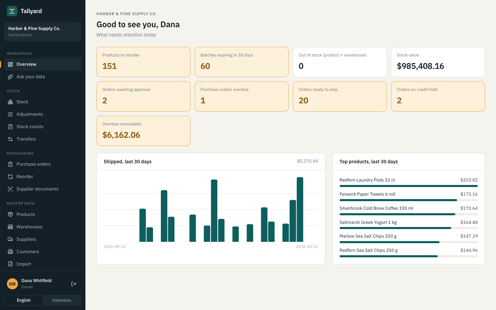

# Tallyard

[English](README.md) · **Bahasa Indonesia**

**[▶ Tonton demo 2:45 dan studi kasus](https://geffaa.github.io/tallyard/)** · video: [`docs/tallyard-demo.mp4`](docs/tallyard-demo.mp4)

[](https://geffaa.github.io/tallyard/)

Sistem operasional untuk distributor/grosir: inventory multi-gudang, pembelian, dan
order-to-cash, dengan lapisan AI yang mengubah dokumen supplier menjadi draft pesanan. Sengaja
bukan ERP penuh (tanpa buku besar, HR, atau payroll); fokus mendalam di tiga alur yang paling
sering membuat distributor rugi. Rencana lengkap: [BREAKDOWN.md](BREAKDOWN.md).

**Status:** keenam milestone selesai.
- **Fondasi:** tenant terisolasi dengan row-level security Postgres, peran dan akses per gudang,
  audit log append-only, data master (produk dengan kemasan dan barcode, gudang, supplier,
  pelanggan).
- **Ledger stok:** saldo per gudang dengan row lock, batch dengan kedaluwarsa yang diambil
  berdasarkan kedaluwarsa terdekat (FEFO), HPP rata-rata bergerak, penyesuaian, transfer dengan
  status dalam perjalanan, kartu stok per produk, dan matriks stok yang ter-update live (SignalR).
- **Pembelian:** purchase order dengan approval bertingkat berdasarkan nilai (tidak ada yang
  bisa menyetujui order sendiri), PDF untuk supplier, penerimaan barang sebagian atau penuh
  (scan barcode dus untuk menghitung satu dus), dan saran reorder yang memperhitungkan barang
  dalam pesanan, dijadikan draft order per supplier dengan satu klik.
- **Order-to-cash:** sales order yang mereservasi stok saat dikonfirmasi (atau menjadikan
  sisanya backorder), cek kredit yang menahan order untuk keuangan (melebihi limit, atau ada
  invoice lewat jatuh tempo lebih dari 30 hari), pengiriman dari stok yang direservasi dengan
  daftar picking FEFO dan surat jalan, satu invoice per pengiriman, pembayaran yang dialokasikan
  ke invoice tertua, dan laporan umur piutang. Data demo berisi riwayat empat bulan.
- **AI (Groq, free tier):** invoice dan penawaran supplier (PDF atau foto) dibaca menjadi draft
  purchase order di layar review berdampingan dengan dokumen aslinya; dan chat yang menjawab
  pertanyaan tentang stok, pembelian, dan penjualan dari query tetap yang mengikuti hak akses,
  menampilkan tabel di balik setiap jawaban.
- **Mulai dipakai:** import Excel untuk produk, pelanggan, supplier, dan saldo awal (divalidasi
  per baris, dipratinjau, diterapkan all-or-nothing); stock opname di HP dengan scanner atau
  kamera; ringkasan hal yang perlu diperhatikan, per peran.

Tidak dibangun (di luar cakupan portfolio ini): buku besar akuntansi, FIFO, multi-mata uang,
konektor Shopify/Odoo, e-Faktur, deploy ke VPS.

## AI: diukur, bukan diasumsikan

Pembacaan dokumen supplier diukur pada 30 invoice fiktif (20 PDF, 10 PNG, 145 baris produk)
dalam empat gaya: rapi, disingkat (`SLVRBRK WHL MLK 1L`, `CS`, kode item supplier), dengan
barcode kita, dan format angka Eropa ([hasil lengkap](eval/supplier-docs/results.md)).

| Ukuran | Putaran pertama | Dengan daftar merek katalog di prompt |
|---|---|---|
| Supplier, nomor dokumen, tanggal, total terbaca benar | 100% | 100% |
| Baris dicocokkan ke produk yang benar | 92% | **99%** |
| … gaya singkatan saja | 63% | **97%** |
| Baris diterima tanpa tanda | 80% | 92% |
| **Produk salah tanpa tanda** | **0 dari 116** | **0 dari 134** |
| Rata-rata waktu per dokumen | 13,8 dtk | 12,4 dtk |

Angka terpenting adalah "produk salah tanpa tanda": kecocokan salah yang tidak diminta untuk dicek
akan menjadi order yang salah. Setiap baris yang tidak pasti selalu ditandai. Kesalahan putaran
pertama semuanya merek yang disingkat (`BLCRST`) yang tidak bisa ditebak model; memberi daftar
merek yang kita jual memperbaiki hampir semuanya.

Chat tidak pernah menulis SQL: hanya memanggil delapan tool tetap yang berjalan sebagai penanya
(tenant-nya lewat RLS, gudangnya, dan tanpa kolom harga untuk peran yang tidak boleh melihat).
Jawaban hanya boleh memakai angka dari hasil tool; tabelnya ditampilkan di bawah jawaban.

## Stack

| Bagian | Teknologi |
|---|---|
| API | ASP.NET Core (.NET 10), minimal API per modul, EF Core + Npgsql, FluentValidation, OpenAPI |
| Web | Angular 20 (standalone components, signals, typed reactive forms, zoneless), Tailwind CSS 4 |
| Database | Postgres 16: row-level security, constraint, pencarian fuzzy `pg_trgm`, partisi bulanan |
| Tes | xUnit + Testcontainers (Postgres asli), NetArchTest untuk batas modul |

Satu deployable: build Angular disajikan oleh ASP.NET dari origin yang sama, sehingga cookie sesi
bisa `HttpOnly` + `SameSite=Strict` tanpa CORS. Alasan memilih stack ini dibanding Laravel, Go,
Node, atau React ada di [BREAKDOWN.md §10.1](BREAKDOWN.md#101-kenapa-arsitektur-ini-dibandingkan-alternatifnya).

## Menjalankan secara lokal

Butuh Docker, .NET 10 SDK, dan Node 20+.

```bash
docker compose up -d                          # Postgres di :5442
cd src/Tallyard.Api
dotnet run -- seed                            # migrasi + data demo (2 tenant)
dotnet user-secrets set Ai:GroqApiKey <key>   # opsional: fitur AI (key gratis di console.groq.com)
dotnet run                                    # API di http://localhost:5080

cd ../../web
npm install
npm start                                     # http://localhost:4210 (proxy /api ke :5080)
```

Atau build web ke dalam API (`npm run build` di `web/`) lalu buka http://localhost:5080.

Login demo: workspace `harborpine`, password `tallyard123`:

| Email | Peran | Yang bisa dicoba |
|---|---|---|
| `owner@harborpine.test` | Owner | semuanya; pengguna, audit log |
| `purchasing@harborpine.test` | Pembelian | mengubah produk dan supplier |
| `warehouse@harborpine.test` | Gudang | hanya melihat gudang Chicago; data master read-only |
| `sales@harborpine.test` | Sales | mengubah pelanggan dan limit kredit |

Tenant kedua, `northpeak` (`owner@northpeak.test`), terisolasi penuh. Semua perusahaan dan produk
fiktif.

## Tes

```bash
dotnet test        # butuh Docker: menjalankan Postgres sendiri
```

Tes berjalan di Postgres asli yang disiapkan persis seperti produksi (script init yang sama;
aplikasi terhubung sebagai role yang bukan pemilik tabel):

- **Isolasi tenant di database:** tanpa tenant, `SELECT count(*) FROM products` menghasilkan 0;
  insert baris untuk tenant lain ditolak oleh policy.
- **Audit log append-only:** `UPDATE`, `DELETE`, dan `TRUNCATE` gagal bahkan untuk pemilik tabel;
  role aplikasi sama sekali tidak punya hak `UPDATE`.
- **Akses:** staf gudang hanya melihat gudangnya; menonaktifkan pengguna langsung mengakhiri
  sesinya di request berikutnya; Owner terakhir tidak bisa diturunkan perannya.
- **Integritas data:** optimistic concurrency (menimpa perubahan orang lain ditolak), satu barcode
  hanya untuk satu produk, perubahan anak (barcode, kemasan) tercatat di riwayat produk.
- **Stok di bawah konkurensi:** 50 request paralel mengambil 1 unit dari produk berstok 10:
  tepat 10 berhasil, 40 mendapat `insufficient_stock`, saldo akhir 0.
- **Invariant ledger:** setiap saldo sama dengan jumlah mutasinya; saldo batch berjumlah sama
  dengan saldo produk; mutasi tidak bisa diubah bahkan lewat SQL; saldo negatif melanggar `CHECK`.
- **Idempotensi:** lima submit bersamaan dengan key yang sama hanya diposting sekali; menerima
  transfer dua kali di saat yang sama hanya diposting sekali (yang kedua mendapat `409`).
- **FEFO dan HPP:** pengeluaran mengambil batch yang paling cepat kedaluwarsa; penerimaan dengan
  harga berbeda memperbarui HPP rata-rata; staf gudang tidak pernah melihat harga.
- **Aturan pembelian:** order 16.500 perlu finance lalu owner; pembuatnya tidak bisa
  menyetujui dan finance tidak bisa mengambil tahap owner; penolakan mengembalikan ke draft
  beserta alasannya; penerimaan melebihi toleransi 5% ditolak, dan dua orang yang menerima sisa
  barang bersamaan tidak bisa sama-sama berhasil; stok dinilai dengan harga beli tanpa pajak;
  staf gudang menerima barang tetapi tidak pernah melihat harga.
- **Menjual unit terakhir:** dua order masing-masing 8 dari 10 unit yang sama dikonfirmasi
  bersamaan: satu mereservasi, yang lain ditolak; order backorder mereservasi yang ada dan
  pembatalan mengembalikannya; hanya stok yang direservasi yang bisa dikirim; setiap pengiriman
  hanya ditagih sekali walau diklik dua orang; hanya yang terkirim yang ditagih.
- **Kredit dan kas:** order yang melebihi limit ditahan (tanpa reservasi) sampai keuangan
  melepasnya dengan alasan; sales tidak bisa melepasnya; pembayaran melunasi invoice tertua dulu
  dan tidak boleh melebihi tagihan; invoice lewat jatuh tempo lebih dari 30 hari menahan order baru.
- **Reservasi cocok dengan order:** jumlah reserved di setiap saldo sama dengan reservasi baris
  order yang terbuka.
- **Tidak ada referensi lintas tenant:** tidak ada saldo, mutasi, baris order, atau aturan yang
  menunjuk produk, gudang, atau supplier tenant lain.
- **Cakupan RLS:** tes gagal jika ada tabel ber-kolom `tenant_id` tanpa row-level security.
- **Batas modul:** setiap modul hanya boleh bergantung pada modul yang diizinkan.

## Keputusan desain

- **Row-level security, bukan hanya `WHERE tenant_id`.** Setiap koneksi yang dibuka EF mengatur
  `app.tenant_id` (`Infrastructure/TenantConnectionInterceptor.cs`), termasuk ke kosong, sehingga
  koneksi dari pool tidak pernah membawa tenant request sebelumnya. RLS aktif tetapi tidak
  di-force: role owner menjalankan migrasi dan seeding, role aplikasi selalu difilter.
- **Id UUIDv7 dibuat aplikasi.** Diketahui sebelum insert (dirujuk audit) dan berurutan waktu
  (ramah B-tree). EF diberi tahu bahwa database tidak pernah membuatnya; tanpa itu, anak baru
  pada parent yang sudah dimuat dikira baris lama.
- **Audit di transaksi yang sama.** Interceptor `SaveChanges` menulis satu baris audit per data
  yang berubah sebelum disimpan, sehingga perubahan dan auditnya tersimpan bersama atau tidak
  sama sekali. Perubahan barcode dan kemasan dicatat di entri produknya.
- **Sesi dicek di setiap request.** Cookie berisi user, tenant, dan peran; setiap request
  memastikan user masih aktif dan perannya masih sama, sehingga pencabutan akses langsung berlaku.
- **Permission, bukan peran, di kode.** Endpoint mensyaratkan permission (`EditCatalog`); satu
  tabel memetakan permission ke peran. Web menerima daftar yang sama untuk menyembunyikan yang
  tidak bisa dipakai; API tetap menegakkannya.
- **Error dengan kode tetap, dalam bahasa request.** `{ code, detail, errors }`: `detail` mengikuti
  `Accept-Language` (Inggris/Indonesia) dan `errors` memakai path field JSON yang dikirim klien
  (`units[0].factor`), sehingga form bisa menaruh pesan di bawah field-nya.
- **Satu jalur kode yang mengubah stok.** `StockLedger.PostAsync` mengunci baris saldo yang
  disentuh dengan urutan tetap (produk, lalu gudang, agar dua posting tidak deadlock), memeriksa
  stok bebas, menulis mutasi append-only, dan memperbarui saldo dalam satu transaksi.
  `CHECK (on_hand >= 0)` dan `CHECK (reserved <= on_hand)` menjadi pengaman: bug menggagalkan
  transaksi, bukan merusak stok.
- **Lock pesimis untuk stok, optimis untuk data master.** Produk laris diubah banyak orang
  bersamaan; row lock mengantrekan mereka alih-alih menggagalkan sebagian besar. Data master
  jarang diubah, jadi memakai cek versi (`xmin`) dan memberi tahu jika orang lain menyimpan duluan.
- **Nomor dokumen tanpa celah.** `ADJ-2026-000042` berasal dari baris counter yang dinaikkan
  dengan upsert di dalam transaksi posting: dokumen bersamaan saling menunggu, dan dokumen yang
  di-rollback mengembalikan nomornya.
- **Dalam perjalanan adalah status nyata.** Mengirim transfer mengeluarkan stok dari gudang
  asal; stok tidak ada di gudang mana pun sampai gudang tujuan menerimanya, dengan HPP saat keluar.
- **Live tanpa bocor.** Setelah posting tersimpan, saldo yang berubah (kuantitas saja, tanpa
  harga) dikirim ke grup SignalR tenant; browser mengabaikan gudang yang tidak ditampilkan.
- **State machine di entity.** Ajukan, setujui, terima, tutup, dan batalkan adalah method di
  `PurchaseOrder` yang menolak transisi yang tidak diizinkan, apa pun tampilan UI-nya. API juga
  mengembalikan aksi yang boleh dilakukan user saat ini, sehingga layar menampilkan tombol yang
  tepat.
- **Seeder lewat role aplikasi.** Data demo dibuat dengan service dan role database yang sama
  dengan request, sehingga RLS memisahkan tenant saat seeding juga. (Versi awal memakai role
  owner yang melewati RLS dan mencampur data tenant; tes lintas tenant kini menjaganya.)
- **Bertipe dari ujung ke ujung.** Tipe API di web di-generate dari dokumen OpenAPI
  (`npm run api:types`); angka JSON strict, sehingga uang bertipe `number`, bukan `number | string`.
- **Teks antarmuka dua bahasa tanpa library.** Kamus bertipe: tabel Indonesia wajib punya kunci
  yang persis sama dengan Inggris, sehingga terjemahan yang hilang menggagalkan build.
